<p align="center">
  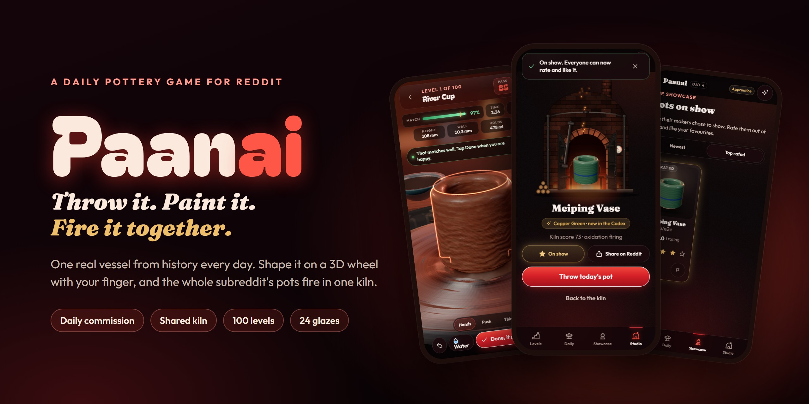
</p>

<p align="center">
  <b>A daily pottery game that lives inside a Reddit post.</b><br>
  Throw a real vessel from history on a 3D wheel, paint it, and fire it in a kiln the whole subreddit shares.
</p>

<p align="center">
  
  
  
  
  
  
  
  
</p>

<p align="center">
  <a href="#how-to-play">How to play</a> ·
  <a href="#features">Features</a> ·
  <a href="#screenshots">Screenshots</a> ·
  <a href="#fair-play">Fair play</a> ·
  <a href="#run-it-locally">Run it</a>
</p>

---

## What is Paanai?

Every day the subreddit gets a new **commission**: a real vessel from a real tradition, such as a Korean moon jar, a Tamil *paanai* or a Song dynasty meiping. Everyone throws the same pot. You shape it on a spinning wheel with your finger, paint it, and put it in the **shared kiln**. All the pots fire together overnight, and the next day the whole community opens the kiln to see what the fire made.

<table>
  <tr>
    <td align="center" width="50%">
      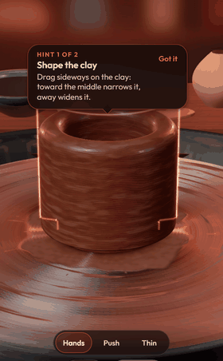<br>
      <sub>Pulling up the wall of a cup on the wheel</sub>
    </td>
    <td width="50%">
      <h3>Why it's different</h3>
      <ul>
        <li><b>You make something.</b> No tiles, no words: wet clay that dries as you work, wobbles before it collapses, and holds the shape you gave it.</li>
        <li><b>One shared fire.</b> The kiln master picks the glaze for every pot, so each firing is a surprise the whole subreddit opens together.</li>
        <li><b>A new piece of history daily.</b> 35 real vessels, each with its origin and a score to beat.</li>
        <li><b>Made for Reddit.</b> Rate pots, like them, share yours as a comment, and challenge other potters to beat your pot.</li>
      </ul>
    </td>
  </tr>
</table>

Built with **Devvit Web** for Reddit's **Game of the Day Hackathon**.

---

## How to play

| Step | Action | What you do |
|:---:|---|---|
| **1** | **See the commission** | The post shows today's vessel, where it comes from, and the score to beat. |
| **2** | **Throw it** | Tap **Open** to open the clay. Drag up the wall to pull it taller and thinner, or sideways to push it in or out. A glowing outline shows the target. The **Done** button glows when your pot passes. |
| **3** | **Get scored** | The server replays your strokes and scores the shape, how even the walls are, and the commission's rules. Your first throw each day is ranked; later throws are practice. |
| **4** | **Paint it** | Turn the pot and paint bands, patterns, the body or the rim. Or leave it bare. |
| **5** | **Fire it** | Pots fire together at **00:00 UTC**. Thin or uneven walls can crack. Your **very first pot** gets a quick 90-second test firing, so you see the whole loop on your first visit. |
| **6** | **Show it off** | Open the kiln, put your pot on show in the Showcase, or share it as a comment on the day's post with one tap. |

> New players get a starter pot fresh from the kiln, a short narrated tutorial, and hints during their first throw. After the tutorial they land straight on today's pot.

---

## Features

| Feature | What it does |
|---|---|
| **Daily Commission** | 35 real vessels in rotation. Everyone throws the same one each day, against a score to beat. |
| **100 Levels** | A hundred sealed kilns, each a vessel to match. Clear one to unseal the next and earn up to three stars. |
| **Realistic wheel** | Wet clay that dries as you work (add water), throwing rings, wheel spin-up, wobble before a collapse, haptics and sound. |
| **Painting** | Bands, patterns, body and rim colours painted straight onto the 3D pot. |
| **The Kiln** | One overnight firing for the whole subreddit. Your shape and the fire decide the result. |
| **Glaze Codex** | 24 effects to discover, from celadon to oil spots. The first potter to fire each one gets their name on it. |
| **The Showcase** | Put pots on show. Everyone can rate them out of five and like them; the most liked becomes **Pot of the Week**. |
| **Share on Reddit** | Posts your pot as a comment on today's post, with its picture and score. |
| **Beat the Commissioner** | Turn one of your fired pots into a challenge post for others to beat. The maker earns patron points. |
| **Ranks and flair** | Apprentice, Journeyman, Artisan and Master Potter, shown as user flair. |
| **Leaderboard** | Today's ranked throws for the commission. |

---

## Screenshots

<table>
  <tr>
    <td align="center">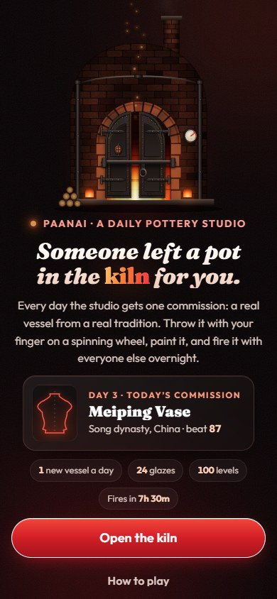<br><sub><b>Welcome</b><br>a pot is waiting in the kiln</sub></td>
    <td align="center">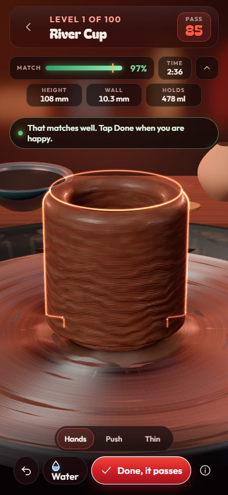<br><sub><b>Throw</b><br>match the glowing outline</sub></td>
    <td align="center">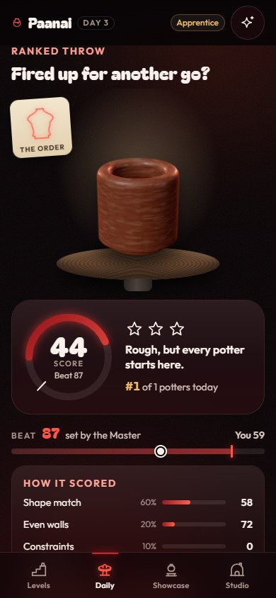<br><sub><b>Score</b><br>checked by the server</sub></td>
  </tr>
  <tr>
    <td align="center">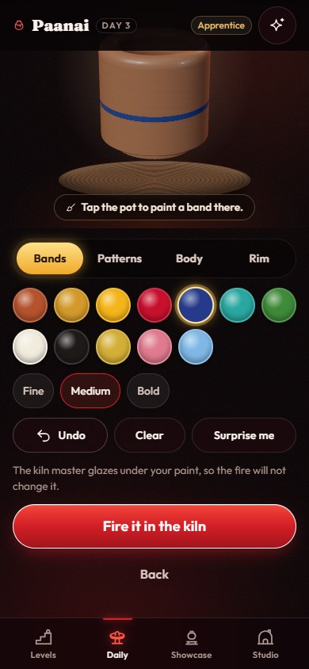<br><sub><b>Paint</b><br>bands, patterns, rim</sub></td>
    <td align="center">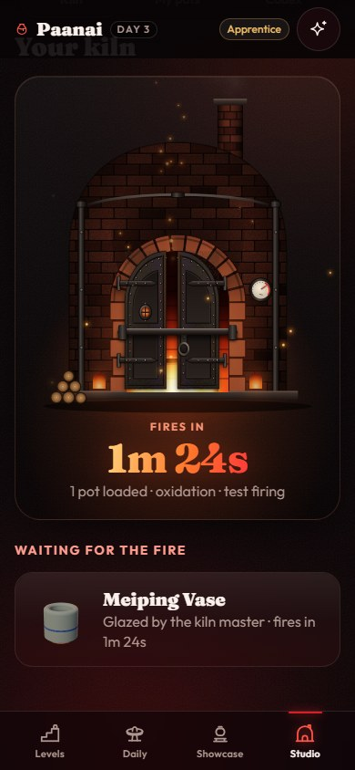<br><sub><b>Kiln</b><br>everyone's pots fire together</sub></td>
    <td align="center">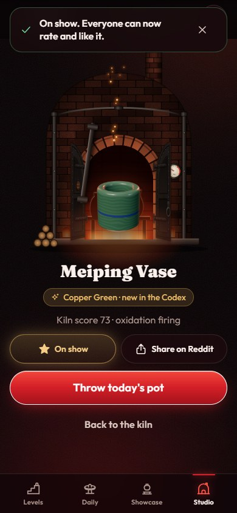<br><sub><b>Reveal</b><br>a new glaze for the Codex</sub></td>
  </tr>
  <tr>
    <td align="center">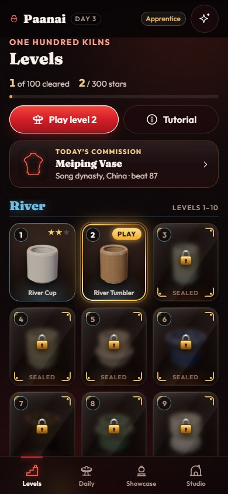<br><sub><b>Levels</b><br>100 vessels to master</sub></td>
    <td align="center">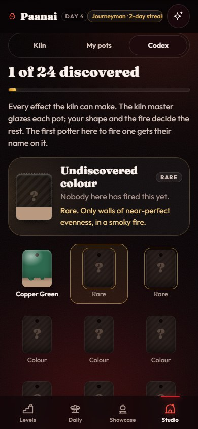<br><sub><b>Codex</b><br>24 glazes to discover</sub></td>
    <td align="center">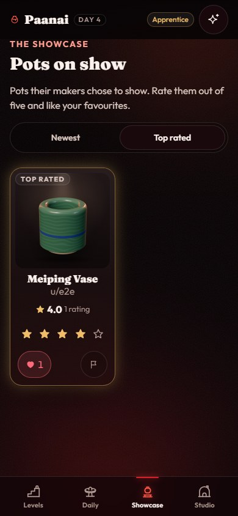<br><sub><b>Showcase</b><br>rate and like other pots</sub></td>
  </tr>
</table>

---

## Fair play

- **Scores can't be faked.** The shaping core is integer-only and deterministic. The client sends only a compact log of strokes, and the server replays it from a fresh lump of clay to score it.
- **One ranked throw per commission**, with rate limits; duplicate submissions are ignored.
- **Community moderation.** Reports auto-hide a pot or challenge after a threshold set by moderators.
- **Mod tools.** Menu items to post today's commission, fire the kiln now, view stats and remove a challenge. Moderators can also require a rank before players can post challenges.

---

## Tech

| Layer | Details |
|---|---|
| **Platform** | Devvit Web 0.15 on Reddit, with scheduler jobs for the daily rollover, kiln firings, the Kiln Report comment and the weekly tally |
| **Server** | Hono and Redis |
| **Client** | Preact with signals; three.js for the wheel, wet clay, painted and glazed pots, and the ghost replay |
| **Feed preview** | `splash.html` loads without three.js, so the Reddit feed stays fast |
| **Audio** | Synthesised live with Web Audio, so there are no sound files to license |
| **Fonts** | Bagel Fat One, Fraunces and Outfit (SIL Open Font License, bundled with their licence files) |

---

## Run it locally

```bash
npm install
npm test               # core, server and content tests (vitest)
npm run harness        # local studio at http://127.0.0.1:5173/studio.html?user=alice (in-memory server)
npm run build
npm run dev            # devvit playtest
```

<details>
<summary><b>Dev tools</b></summary>

- `node tools/e2e.mjs` plays through the whole game as a new player (21 steps, harness must be running).
- `/dev/throw-lab.html?target=moon-jar` shows the wheel on its own.
- `node tools/shoot.mjs` runs a scripted throw and takes screenshots.
- `node tools/playthrough.mjs` clicks through every screen.
- `npx tsx tools/check-commissions.ts` validates all 35 commissions.

</details>

<details>
<summary><b>Project layout</b></summary>

```
src/shared/core      deterministic shaping, strokes codec, survival, scoring, glazes, firing
src/shared/content   the 35 commissions and the gesture DSL for Master throws
src/server           routes, services (daily, throws, kiln, community, commissions), platform (Devvit / memory)
src/client/three     throw stage, wet clay and glaze shaders, wheel, offscreen pot renderer
src/client/studio    the expanded app: screens, store, controller
src/client/ui        glass UI kit
```

</details>

---

<p align="center">
  <sub>Made with clay, fire and TypeScript for the Reddit Game of the Day Hackathon.</sub>
</p>
